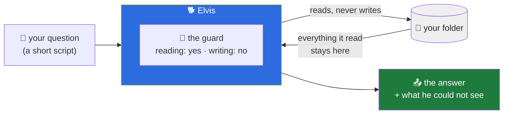

# Elvis — the hound that reads

> **He goes into the folder, finds the answer, and comes back. He does not touch anything — and he tells you where he could not look.** *"You ain't nothin' but a hound dog."*

You point Elvis at a folder and give him one short Python script. The script walks the folder,
reads what it needs, and reports back a handful of lines. Everything it read stays behind; only
the answer comes out. **He is read-only: while that script runs, nothing on your disk gets
written, renamed or deleted.**

He was built for one job — **letting an AI agent ask a question about a folder without pouring the
whole folder into its memory** — and he is small enough to read in an afternoon. One file, no
packages to install.

---

## 🖼️ How it works



**In words, for anyone reading with pictures off:** your script goes in, Elvis runs it inside your
folder with a guard standing over it, the folder is read but never changed, and what comes back is
the small answer plus an honest note of anything he could not look at.

---

## 😫 The problem

You ask an AI agent: *"which of these 887 files mention X, and which have no date?"*

The agent calls a tool once per file and reads every result into its memory. **Most of what it
reads is output nobody needed.** You pay for all of it, and the answer you wanted is buried in the
middle.

**The cost is not the searching. The cost is reading output that nobody needs.** One tool call per
file means one result per file lands in the agent's memory, whether it matters or not.

**What Elvis does instead:** the AI agent writes one small script that walks the folder itself and
reports only what it decided to report. Elvis runs that script in a separate process and sends back
one small result. Everything the script read stays in that process.

> **Measured on one real 304-file folder: 2.1 MB read, a 669-byte answer, 4.3 seconds.**
>
> *That is one folder on one day, on the machine this was built on. It shows the shape of the
> saving, not a promise for your folder.*

**And why he is read-only:** the script he runs was written by a model a moment ago and nobody has
read it yet. A stray `open(path, "w")` — *a line that opens a file in order to overwrite it* — or a
delete in generated code is exactly the accident this guards against.

---

## ▶️ Install and run it

**Get it.** One file, one job. No packages, no agent framework, no account.

```bash
git clone https://github.com/alphasyomega/elvis-hound
cd elvis-hound
```

| | |
|---|---|
| **What it needs** | Python 3 and nothing else. The script says 3.8 or newer. If `python` is not on your PATH, use `py -3` in its place |
| **Where it runs** | Windows and Linux, in the script's own words. Verified on Python 3.12.10 on Windows 10. Linux and macOS untested here |
| ⚠️ **What it does not cover** | a script you do not trust. **He stops accidents, not attacks.** Read **Limits and scope** before running anything you did not write |

**Prove it works on your machine first.** This must end with `selftest: pass`:

```bash
python elvis.py --selftest
```

That runs 66 checks against the engine itself. It takes about twenty seconds, because most of those
checks start a fresh child process — *measured at 17.6 seconds on Python 3.12.10 on Windows 10.*
**If it passes, what this page promises is true on your machine, not just on ours.**

Now a real run. Save this as `find_todo.py`:

```python
hits = box.grep(r"TODO", "**/*.md")
box.report(count=len(hits), files=sorted({h[0] for h in hits}))
```

And point him at a folder of your own:

```bash
python elvis.py --root notes --script find_todo.py
```

Wherever a command on this page says `notes`, put the path of a folder of your own. **That folder
is the only place the script is allowed to look.**

---

## 🧰 How to use it

**A script from a file**, as above. **A script typed straight in**, so one run needs no temporary
file — give `--script` the value `-`:

```bash
echo "box.report(n=len(box.list('**/*.md')))" | python elvis.py --root notes --script -
```

**Several folders at once.** Repeat `--root`. A path is allowed when it is inside any of them:

```bash
python elvis.py --root notes --root more --script find_todo.py
```

**With no `--root` at all**, the folder you are standing in is the single root.

**Raw JSON** instead of the readable summary — *JSON is the plain-text format programs read* — which
is what another program calling this should use:

```bash
python elvis.py --root notes --script find_todo.py --json
```

**The other flags:** `--timeout N` is the limit in whole seconds (default 60). `--max-file-bytes N`
caps one file (default 2 MB). `--max-total-bytes N` caps everything one run reads (default 64 MB).

### What the script gets

The script runs with its working folder set to the first root, and gets one ready-made helper
named `box`:

| Name | What it does |
|---|---|
| `box.roots` | the full paths of the roots, as a list |
| `box.root` | the first root, `box.roots[0]` |
| `box.list(glob="**/*")` | sorted file paths, searched in every root. Relative to the root for the first one, full paths for the others. Every path it returns works in `box.read` |
| `box.read(path, max_bytes=None)` | the text of a file under a root. Counted in coverage |
| `box.lines(path)` | the same file as a list of lines |
| `box.grep(pattern, glob="**/*")` | a list of `(path, line number, line)` for a search pattern |
| `box.report(**fields)` | what comes back to you. Calls merge, and a later value for the same name replaces the earlier one |
| `box.note(text)` | a short human line, added to `notes` in order |

Anything the script prints is captured and returned under `notes` as `stdout: ...` lines. **It never
becomes part of `reported`.**

A file over the size cap, or past the total budget, is **not read**: `box.read` returns an empty
string and the file is listed under `coverage.skipped` with the reason.

### What comes back

One result with nine fields:

| Field | What it holds |
|---|---|
| `outcome` | one of the four below |
| `error` | nothing, or a sentence saying what went wrong. Most carry the error type first; a missing root, a timeout and a child failure read as plain sentences |
| `error_kind` | nothing, or one word for the kind of thing that happened, so a program can branch without reading the sentence: `script_invalid`, `script_error`, `operation_denied`, `path_refused`, `timed_out`, `budget_exhausted`, `file_cap_exceeded`, `could_not_read`, `direct_observation_failed` |
| `reported` | exactly what the script reported, nothing added |
| `notes` | the script's notes, anything it printed, and any refusals |
| `coverage` | nine fields of its own, below |
| `refusal_count` | how many operations were refused in total, counted even when the script swallowed the error |
| `refusals_truncated` | `true` when more refusals happened than `notes` shows |
| `refusals_truncation_why` | nothing, or why they were cut |

**`coverage` holds:**

| Field | What it holds |
|---|---|
| `files_seen` | files the run looked at |
| `files_read` | files it actually read |
| `bytes_read` | how many bytes those reads returned |
| `skipped` | a list of files it knows it did not read, each with the reason |
| `complete` | `false` when the run fell short of what it was asked to look at |
| `incomplete_why` | the causes, when `complete` is `false` |
| `direct_observations` | how many times the script looked at something by itself rather than through `box` |
| `direct_observation_failures` | how many of those failed |
| `unknown_failures` | read failures the run saw but could not pin on a particular file |

🔴 **Read `coverage` next to every result, `found` included.** A script can report something real
and still have fallen short of what it was asked to look at. **`found` says the script reported. It
does not say the run saw everything.**

### The four answers he can give

| Outcome | What it means |
|---|---|
| `found` | the script reported something |
| `none` | the script ran clean and reported nothing |
| `could_not_look` | a root is missing or unreadable, the script itself is missing, or every file the script tried to read was skipped or unreadable |
| `crashed` | the script raised an error, would not compile, was refused by the guard, or ran out of time. `error` says which |

**A run that fell short says so.** `coverage.complete` is `false` when the run skipped files it was
asked to read, and `coverage.incomplete_why` says why. **That is how a run that was cut short tells
itself apart from a complete run that genuinely found nothing.**

**An empty success is never reported as success.** If a root is missing, the script is missing, or
every file it tried to read was skipped, you get `could_not_look` and not a quiet nothing.

**A refusal is never swallowed either:** refusals have their own budget, separate from whatever the
script prints, so a chatty script cannot crowd one out. The result carries the total in
`refusal_count`, plus `refusals_truncated` and `refusals_truncation_why` when only the first few are
shown.

**And read `coverage` next to every `none`:** `none` means the script reported nothing, and
`files_seen: 0` beside it means the script may never have looked at anything at all.

### Exit codes

| Exit | What it means |
|---|---|
| `0` | `found` or `none` |
| `2` | `could_not_look` (also what a bad command line gives, such as a missing `--script`) |
| `3` | `crashed` |

`--selftest` exits `0` on pass and `1` on fail.

---

## 📏 Limits and scope

**He is a house dog. He checks your own place.**

| | |
|---|---|
| ✅ **Use him on** | your own folders, with scripts you or your agent wrote, on your own machine |
| 🚫 **Not for** | code from strangers, a shared service, untrusted input |

### What he watches, and what he does not

| | Confined? | |
|---|---|---|
| **Reading what is inside a file** | ✅ | outside the roots it is refused and counted |
| **Listing a folder** | ✅ | outside the roots it is refused and counted |
| **Writing, deleting, network, starting a program** | ✅ | refused anywhere, whenever Python raises the alarm. See the two gaps below |
| **Asking whether a file exists, its size, its dates** | ❌ | **not confined.** See gap one |
| **A script written to break out on purpose** | ❌ | **not stopped.** Python is not a prison |

### What he refuses outright

**The engine is read-only.** A guard — *Python can announce every time a program is about to touch a
file; that announcement is what Elvis listens to* — is installed in the child process before the
script's first line. A refusal both raises an error and is recorded, **so a script that swallows the
error still ends `crashed`:**

| What | What is refused |
|---|---|
| **Writing** | `open()` for write, append, create or update, and the matching low-level flags |
| **Deleting and changing** | `os.remove`, `os.rename`, `os.rmdir`, `os.mkdir`, `os.truncate`, `os.chmod`, `os.symlink`, `os.link`, `os.utime` and friends, and every `shutil` operation |
| **Databases** | `sqlite3.connect` — named on its own, and gap two says why |
| **Network** | `socket`, `urllib`, `http.client`, `ftplib`, `smtplib`, `telnetlib`, and `ctypes` library loads |
| **Starting a program** | `subprocess`, `os.system`, `os.exec*`, `os.spawn*`, `os.fork`. There is no door: the engine starts no program of yours |
| **Paths outside the roots** | every path given to `box` is resolved, shortcuts included, and must stay under a root. `..`, full paths and links that leave the root are refused by name. Plain `open()` and `os.listdir()` are confined the same way. Python's own install folders stay readable so imports work |

A timeout kills the child process: `crashed`, `timed out after N seconds`.

### Gap one — what a file *is*, as opposed to what is inside it

**The contents of a file are confined. What a file *is* — whether it exists, its size, its dates —
is not.**

A script can ask about a path outside the roots and get an answer. **It still cannot open that file:
reading content, listing a folder, and every write are confined and refused as documented.**

**This is a limit of the mechanism, not an oversight.** Python makes no announcement for those
questions, so there is nothing for the guard to hear. So the coverage a run reports speaks about
file contents and folder listings — the things the guard can actually watch — and never about those
questions.

*If keeping neighbouring folders private matters to you, this is not the tool for that boundary.
Use an operating-system sandbox.*

### Gap two — a library that writes from its own built-in code

The guard hears what Python announces. **A library that opens and writes a file from its own
built-in code makes no announcement, so the guard never hears that write.**

`sqlite3` is the one we met. A four-line script that opened a database inside the root created the
file **while the run reported no refusals and complete coverage.** `sqlite3.connect` is refused now,
and a self-test fails if that refusal is ever removed.

**What stays true in general: a library that does its own file writing can write without this guard
hearing it.** We do not claim to name them all, and no guard written inside Python can.

> *So the honest promise is this: **every write Python itself performs is refused**, and anything
> else is caught the way dust is caught — **not by sealing the house, but by sweeping it.** Keep the
> folder you point this at under version control, or compare it before and after, and an unexpected
> file has nowhere to hide for long.*

### ⚠️ Before you run him on anything you did not write

> 🔴 **DO NOT SEND THE DOG TO LOOK AT UNTRUSTED CODE.**
> **Elvis is not a sandbox. He is your house dog.**
> For code you do not trust, use an operating-system sandbox: a container, a separate user, no
> network.

🐕 **He stops accidents, not attacks.** The guard and the path confinement stop the mistakes a
generated script makes: a stray write, a delete, a path that wanders off, a call to the network.
**They do not stop a script that is *trying* to escape** — a determined one can reach around the
guard, rewrite the engine's own pieces while it runs, forge the result on the way out, exhaust the
machine, or use something the interpreter never announces.

**The rest, said plainly:**

- 📖 **A read the script makes by itself is counted, but in less detail.** `open`, `io.open`,
  `pathlib`, `os.open`, `os.listdir` and `os.scandir` all appear in `coverage.direct_observations`,
  and a failure among them lands in `coverage.direct_observation_failures` even when the script
  swallows it. What they do **not** do is count against the byte budgets or name the file in
  `coverage.skipped` the way a `box.read` does. **Use `box` when you want the accounting — the
  direct route still cannot hide that it happened.**
- ❓ **A failure the run cannot pin on a particular read** lands in `coverage.unknown_failures`, and
  the coverage is not declared complete. The run would rather say *"something failed and I am not
  sure whose it was"* than guess.
- ⏱️ **Memory and processor time are limited only by the timeout.**
- 📦 **The size of `reported` is not capped.**
- 📍 **With several roots, paths from the second root onward come back as full paths**, so a result
  can carry folder names from the machine it ran on. **Check what you paste or send onward.** *Not a
  gap in the guard — just something to know.*

*"Read-only" describes what the guard listens for — not a promise about every way Python can touch a
disk.*

*We built this for one house, and we kept it that size on purpose. It makes a real promise it can
keep, instead of a bigger one it cannot.*

---

## 🏠 Shape it to your house

**This was built for one small setup, on purpose, and yours certainly is shaped
differently.** What is here is a baseline meant to be changed. Everything below lives in `elvis.py`, near the top, named so you can
find it without counting lines:

| What you might want | Where it lives | What to do |
|---|---|---|
| **Refuse something else** — another library, another kind of call | `_BLOCKED_EXACT` and `_BLOCKED_PREFIX` | add the name to the list. `sqlite3.connect` is in there as a worked example |
| **Allow something we refuse** | the same two lists | take the name out — **and add a check of your own that fails if it ever creeps back** |
| **Bigger or smaller files** | `DEFAULT_MAX_FILE`, `DEFAULT_MAX_TOTAL` | the per-file and per-run byte caps, also settable per run on the command line |
| **Longer runs** | `DEFAULT_TIMEOUT` | seconds, also settable per run |
| **More or fewer notes kept** | `MAX_NOTES`, `MAX_REFUSALS`, `MAX_LINE_CHARS` | how much of a chatty run is kept, and how long each line may be |
| **Your own helper on `box`** | the `_Box` class | add a method; anything it reads goes through `box.read`, so coverage keeps counting |

🔴 **Whatever you change, change the self-test with it.** Add a check that fails when your change is
taken out — *that is the difference between a test that decorates and a test that guards.* Then run
`python elvis.py --selftest` and watch the count go up.

**If your setup is bigger than one person's folders:** this is the wrong shape for you. A shared
service, untrusted code, or anything with a real attacker on the other side needs an
operating-system sandbox underneath, and Elvis is not that. **He was built so a script written by a
model a moment ago cannot wreck your notes by accident. Nothing more, and that on purpose.**

---

## 📁 What is in this folder

| File | What it is |
|---|---|
| `elvis.py` | the whole engine and its self-test, in one file, standard library only |
| `LICENSE` | MPL-2.0 |
| `CREDITS.md` | whose idea this is |

---

## 🙏 Credits

**Built by [alphasyomega](https://github.com/alphasyomega) and Claude.**

**The gap that `sqlite3` walked through was found by Aya
([@ayakohi](https://github.com/ayakohi)) and Cygnus**, who tested this repository against the
promises on this page and wrote up what they found. The lock, and the honest wording of the limits,
exist because of that reading. Thank you.

**The idea this piece is built on:**

An AI agent that writes code which makes its own tool calls, instead of calling one tool at a time.
The name **Code Mode** is **Cloudflare's**: https://blog.cloudflare.com/code-mode-mcp/
**Anthropic** published their own version as *"code execution with MCP"*, crediting Cloudflare as
the inspiration: https://www.anthropic.com/engineering/code-execution-with-mcp
Claude Code's terminal feature carries the name too: https://code.claude.com/docs/en/code-mode

**No code was taken.** This engine was written from scratch, because neither version runs where it
was needed: Claude Code's Code Mode is terminal-only, and Anthropic's runs in a sandbox that cannot
reach your own folders. **The idea carries Cloudflare's and Anthropic's names all the same.**

Full list: [CREDITS.md](CREDITS.md)

---

## 📄 Licence

MPL-2.0. See [LICENSE](LICENSE).

---

*With love, for Love.*
